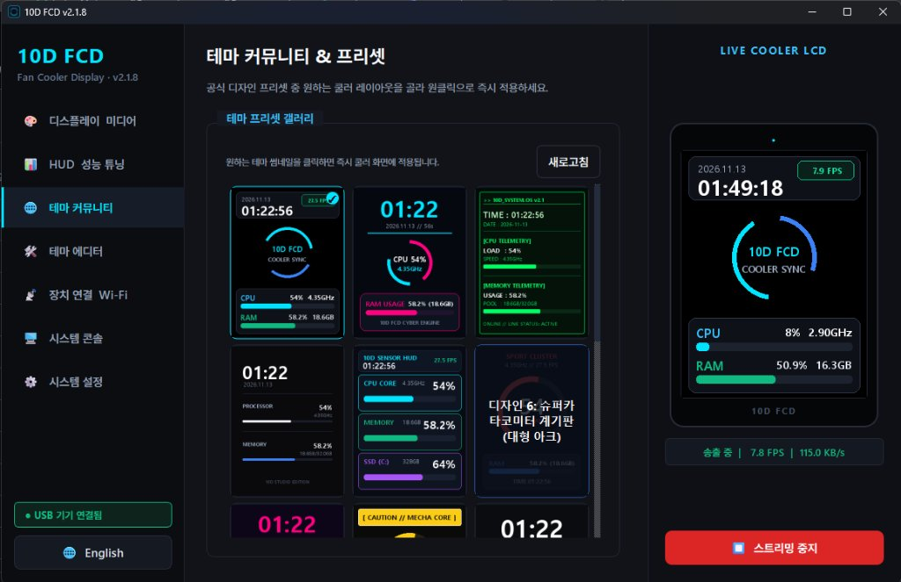
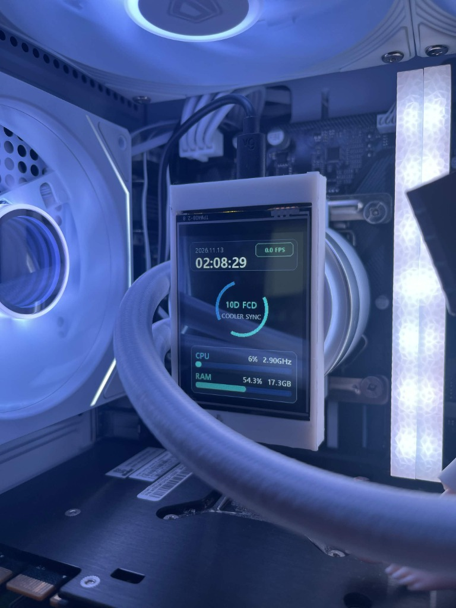
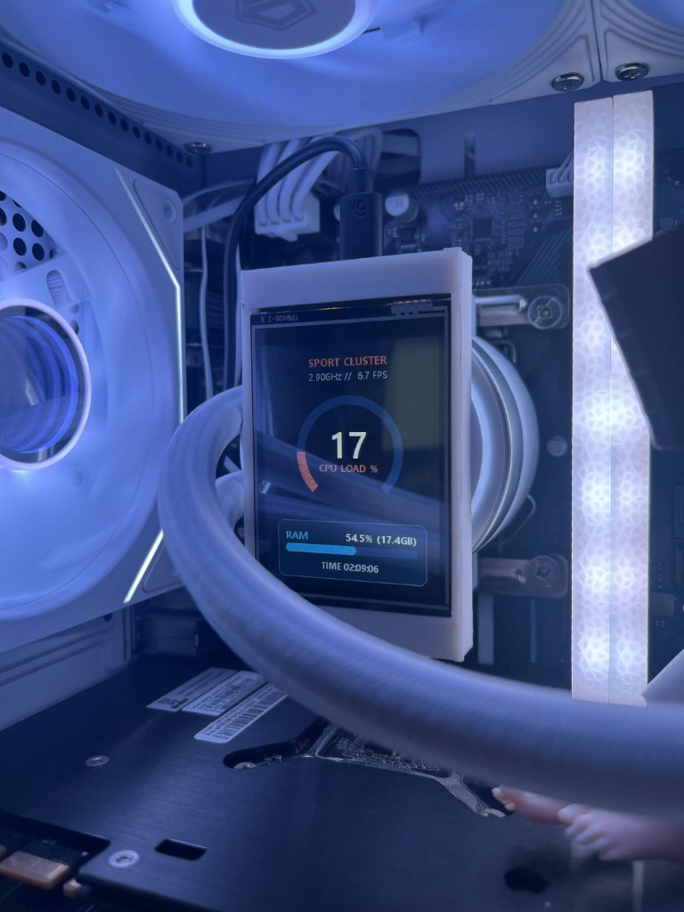
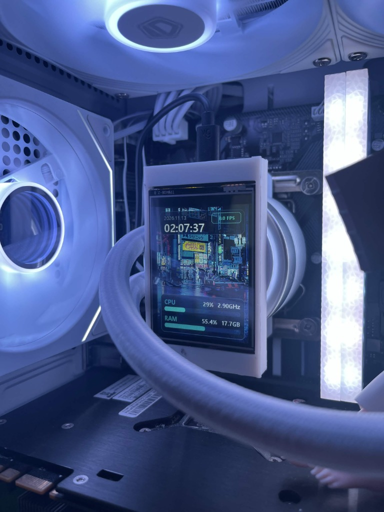
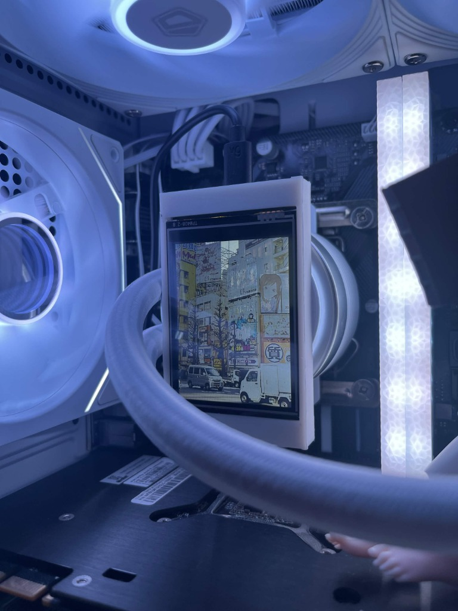

# 10D-FCD (Fan Cooler Display)

[English](README_EN.md) | 한국어

알리익스프레스 등에서 1~2만 원대에 쉽게 구할 수 있는 **ESP32-2432S028 (CYD)** 2.8인치 LCD 보드를 PC 수랭/공랭 쿨러 팬이나 본체 내부에 장착해 실시간 시스템 정보(CPU, RAM, 시계 등)를 무선(Wi-Fi)으로 띄워주는 프로그램입니다.

### PC 클라이언트 제어 화면

  

### 실제 장착 구동 모습

  
  
  
  

---

## 다운로드

- **[최신 버전 다운로드 (Releases)](https://github.com/82-nosty/10D-FCD/releases)**
- `10D_FCD_Setup_vX.X.X.exe` 파일을 받아 설치하시면 됩니다.

---

## 준비물

1. **ESP32-2432S028 보드** (일명 Cheap Yellow Display, 2.8인치 저항식 터치 모델)
2. **USB 케이블** (보드와 PC 연결용)
3. **쿨러 장착 브라켓/커버** (필요 시 `cover/FCD_Cover.3mf` 3D 프린팅 파일 사용)

---

## 사용 방법

### 1. ESP32 보드에 펌웨어 업로드

1. [Arduino IDE](https://www.arduino.cc/en/software)를 엽니다.
2. 라이브러리 관리자에서 아래 2개를 설치합니다:
   - `TFT_eSPI`
   - `TJpgDec`
3. **중요: CYD 핀맵 설정**:
   - 저장소 루트에 있는 **`User_Setup.h`** 파일을 복사하여 내 문서의 Arduino 라이브러리 경로(`Documents/Arduino/libraries/TFT_eSPI/User_Setup.h`)에 덮어씁니다.
4. `cyd_streamer.ino`를 열고 보드를 **ESP32 Dev Module**로 선택한 뒤 업로드합니다.

### 2. PC 프로그램 실행 및 Wi-Fi 연결

1. 다운로드한 `10D FCD` 설치 프로그램을 실행합니다.
2. 보드를 USB로 PC에 연결합니다.
3. 프로그램의 **[장치 연결 Wi-Fi]** 탭에서:
   - 포트(COM)를 잡고 `연결` 클릭
   - 집에서 쓰는 공유기(2.4GHz)를 골라 비밀번호 입력 후 `공유기 연결` 클릭
4. 보드 화면에 IP 주소가 뜨면 설정이 끝납니다.
5. 우측 아래 **[▶ 무선 스트리밍 시작]**을 누르면 화면이 전송됩니다.

> 이후에는 USB를 PC 본체 USB 포트나 충전기에만 꽂아두면 PC와 무선으로 통신합니다.

---

## 자주 묻는 질문 (FAQ)

- **Q. 보드 화면이 하얗게(백화)만 나와요:**
  - `TFT_eSPI` 라이브러리의 핀맵 설정 문제입니다. 저장소에 포함된 `User_Setup.h`를 라이브러리 폴더에 제대로 덮어썼는지 확인해 주세요.
- **Q. Wi-Fi 검색이 안 되거나 접속 실패가 떠요:**
  - ESP32는 **2.4GHz Wi-Fi만 지원**합니다 (5GHz Wi-Fi는 목록에 뜨지 않습니다). 공유기의 2.4GHz 대역에 연결해 주세요.
- **Q. 화면 방향이 거꾸로 장착되었어요:**
  - PC 프로그램의 **[시스템 설정]** 탭에서 `화면 180도 회전`을 체크하시면 즉시 반전되며, 보드 자체(NVS)에 저장되어 재부팅해도 유지됩니다.

---

## 주요 기능

- **14가지 기본 테마**: AIDA64 스타일 센서창, 슈퍼카 타코미터, 레트로 네온, 미니멀 시계 등
- **화면 180도 회전**: 쿨러 장착 방향에 맞춰 화면을 뒤집을 수 있으며, 보드 자체에 저장되어 껐다 켜도 유지됩니다.
- **단독 시계 모드**: PC를 끄면 자동으로 인터넷 시계(NTP) 모드로 전환됩니다.
- **백그라운드 실행**: 트레이 아이콘으로 최소화 및 윈도우 시작 시 자동 실행 지원

---

## 라이선스 및 면책 조항

- 본 프로젝트의 자체 소스코드는 [MIT License](LICENSE)를 따릅니다. (Copyright 2026 Nosty)
- 사용된 제3자 오픈소스 라이브러리 라이선스 목록은 [CREDITS.md](CREDITS.md)를 참고하세요.
- **면책 고지**: 본 소프트웨어와 펌웨어는 있는 그대로(AS IS) 제공됩니다. 쿨러 팬 장착, 배선 연결, 하드웨어 개조 등으로 인해 발생하는 시스템 오작동이나 하드웨어 파손, 데이터 손실에 대해 제작자는 어떠한 법적 책임도 지지 않습니다. 안전을 위해 올바른 전압(5V)과 규격 배선을 준수해 주십시오.
