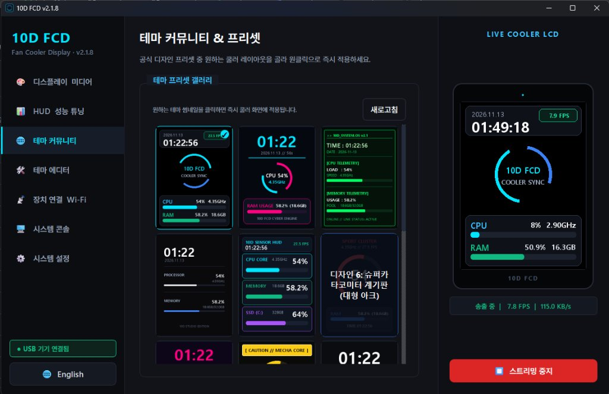
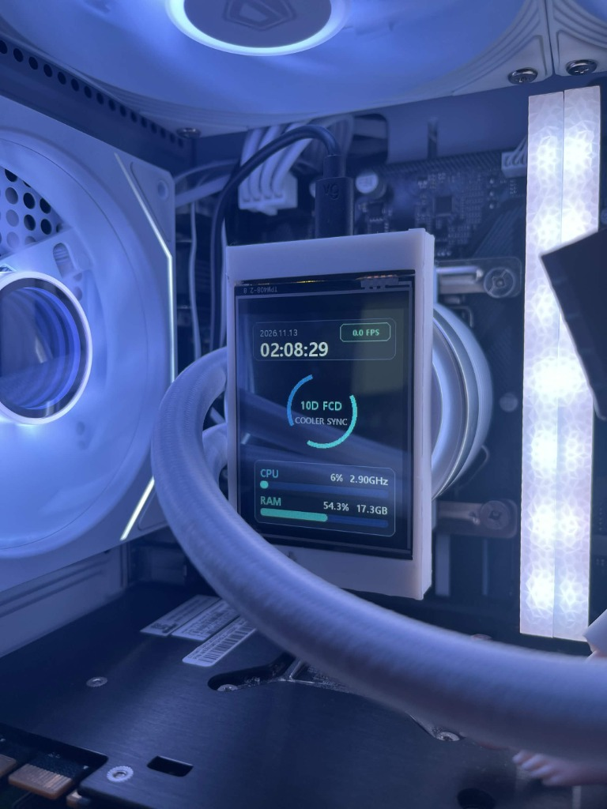
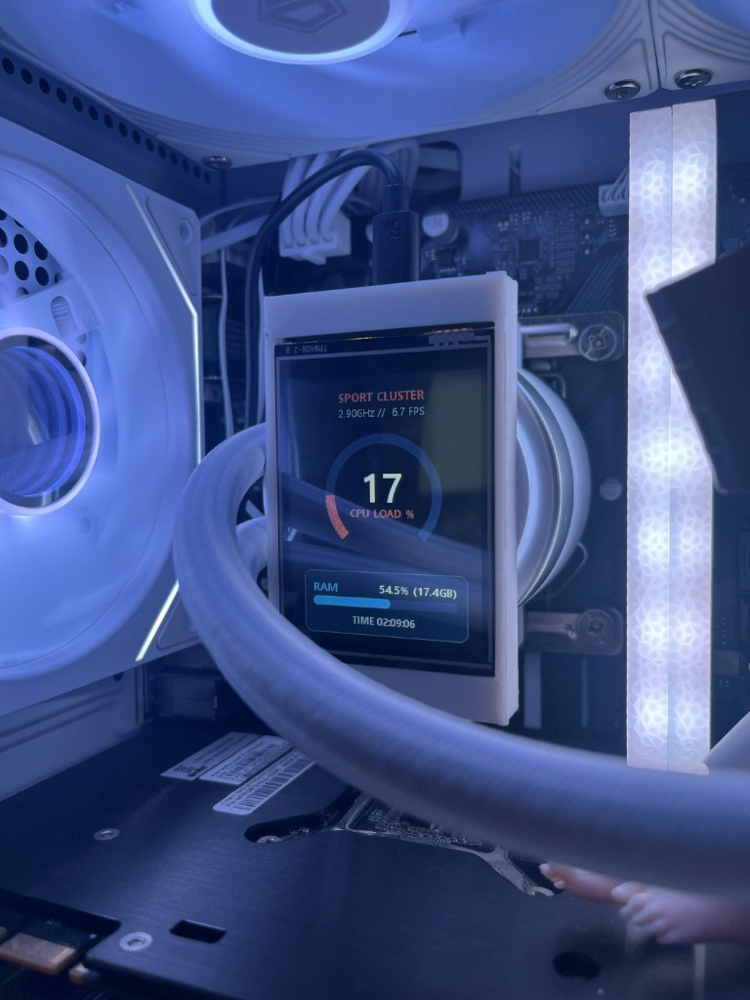
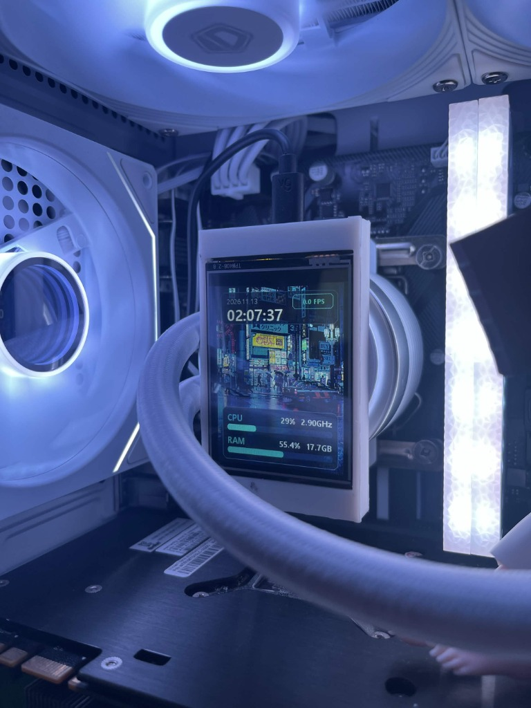
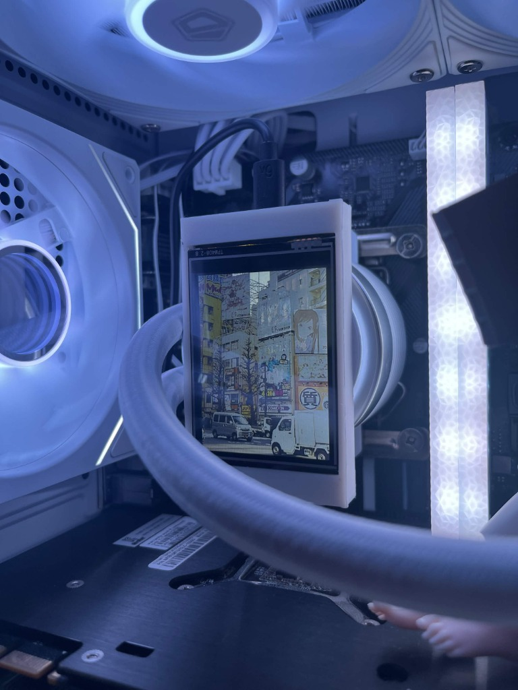

# 10D-FCD (Fan Cooler Display)

English | [한국어](README.md)

A wireless PC telemetry display for cooler fans and PC cases using the affordable ($10–$15) **ESP32-2432S028 (CYD)** 2.8" LCD board. Streams real-time CPU, RAM, clock speed, and date/time over Wi-Fi.

### PC Client Interface

  

### Real Hardware in Action

  
  
  
  

---

## Download

- **[Download Latest Installer (Releases)](https://github.com/82-nosty/10D-FCD/releases)**
  - **Windows**: `10D_FCD_Setup_vX.X.X.exe`
  - **macOS (Apple Silicon & Intel)**: `10D_FCD_macOS_vX.X.X.dmg` (macOS 12 Monterey or later)

> **macOS Note**
> - On first launch, macOS Gatekeeper may show an "unidentified developer" warning. **Right-click (or Control+click) ➔ [Open]** to run.
> - If using screen streaming/mirroring mode, enable Screen Recording permission under **[System Settings] ➔ [Privacy & Security] ➔ [Screen & System Audio Recording]**.

---

## Hardware Requirements

1. **ESP32-2432S028 board** (2.8" TFT-LCD "Cheap Yellow Display")
2. **USB Cable** (Micro USB or Type-C, for initial flashing and Wi-Fi provisioning)
3. **Mount / Cover (Optional)**: 3D-printable fan cover model is included (`cover/FCD_Cover.3mf`)

---

## Quick Setup

### 1. Flash the Board

1. Open [Arduino IDE](https://www.arduino.cc/en/software).
2. Install these two libraries via Library Manager:
   - `TFT_eSPI`
   - `TJpgDec`
3. **Important: CYD Pin Configuration**:
   - Copy the **`User_Setup.h`** file from the root of this repository and replace the file in your Arduino libraries directory (`Documents/Arduino/libraries/TFT_eSPI/User_Setup.h`).
4. Open `cyd_streamer.ino`, select board as **ESP32 Dev Module**, and upload.

### 2. Wi-Fi Configuration & Streaming

1. Install and run `10D FCD` on your PC.
2. Plug the CYD board into your PC via USB.
3. In the **[Device & Wi-Fi]** tab:
   - Select your COM port and click `Connect`.
   - Scan your 2.4GHz Wi-Fi AP, enter the password, and click `Apply Wi-Fi`.
4. The board will display its assigned IP address once connected.
5. Click **[▶ Start Wireless Stream]** on the bottom right.

> After initial setup, the board only needs 5V USB power (from a motherboard header, case port, or phone charger) to stream wirelessly.

---

## FAQ

- **Q. The screen is blank white:**
  - This is a `TFT_eSPI` pin configuration issue. Ensure you copied the included `User_Setup.h` into your `Arduino/libraries/TFT_eSPI/` directory.
- **Q. Wi-Fi network not found:**
  - ESP32 only supports **2.4GHz Wi-Fi bands** (5GHz networks will not appear in the scan list). Connect to a 2.4GHz network.
- **Q. The screen is mounted upside down:**
  - In the PC client's **[Preferences]** tab, toggle `Flip 180°`. The orientation is permanently saved to the ESP32's NVS storage.

---

## Features

- **14 Built-in Themes**: AIDA64-style sensor panel, supercar tachometer, retro synthwave, minimal clock, and more.
- **180° Hardware Rotation**: Invert screen orientation to fit your cooler mount. Persists in ESP32 NVS across reboots.
- **Standby Clock**: Automatically falls back to an NTP digital clock when the PC is turned off.
- **System Tray & Startup**: Minimize to tray and launch with Windows startup.

---

## License & Disclaimer

- The project source code is licensed under the [MIT License](LICENSE). (Copyright 2026 Nosty)
- For third-party open-source libraries and credits, see [CREDITS.md](CREDITS.md).
- **Disclaimer**: This software and firmware are provided "AS IS", without warranty of any kind. The author shall not be held liable for any hardware damage, cooling failures, shorts, or data loss arising from installation, modification, or use of this project. Always ensure correct wiring and voltage (5V).
